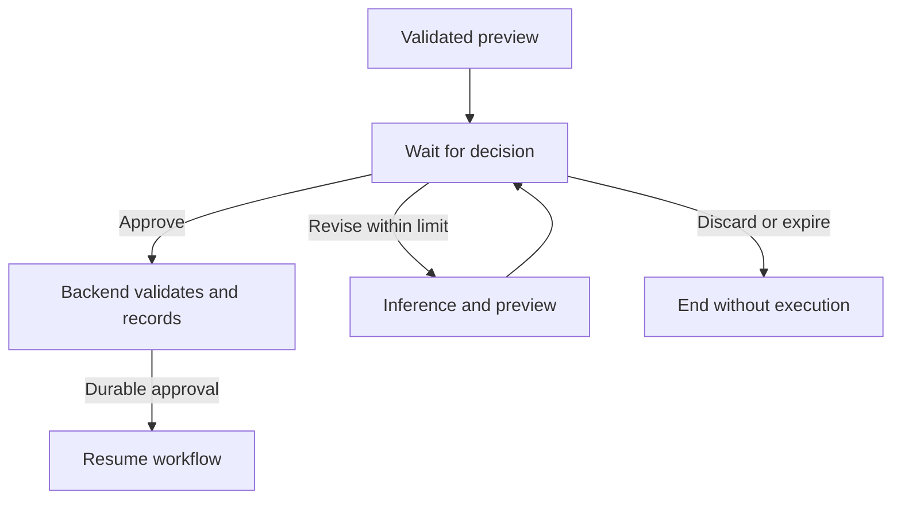

# Architecture orchestration and communication

Status: First-draft architecture decision record; selections from the seven-stage whiteboard review, not a deployed or validated implementation.
Updated: 2026-11-17

## Scope and ownership

This ADR records orchestration, communication and enforcement boundaries for support-ticket CSV onboarding into the CRM-shaped Support Case contract. The [functional requirements](functional-requirements-v1.md), [NFRs](nonfunctional-requirements-v1.md) and [contract](support-case-contract-v1.md) remain authoritative for behavior. The [service matrix](aws-service-mapping-draft.md) allocates AWS resources; [logical workflows](architecture-workflows.md) describe the paths.

For the subsequent network and anonymous-access decisions, see the [network-boundaries ADR](adr-network-boundaries.md). It selects restricted worker connectivity and an explicit application-backend exception; deployment remains unvalidated.

All seven stages were reviewed: entry/intake, mapping, review/approval, transformation, results/audit, reuse/reprocessing, and background operations. This completes a responsibility-level pass, not all architecture work. Model, execution engine, detailed protocols, costs and several consistency mechanisms remain unvalidated.

The demo remains interactive: visitors normally stay on the page for progress and results. Browser status polling and a durable Step Functions execution replace the earlier assumption that one backend Lambda synchronously coordinates the entire user journey. Step Functions may wait for an executor task; no Lambda or HTTP connection stays open while a human reviews. Polling is asynchronous communication even when the visitor remains on the page (NFR-9.1). HTTP API request limits still apply to each request.

## Component responsibilities

| Component or operation | Owns | Does not own |
| --- | --- | --- |
| Browser interface | Human-verification widget, upload, rules/preview/revision controls, polling, backend downloads | Authoritative authorization, approval, quota or outcome decisions |
| Application backend on Lambda | Distinct entry/session, intake, review-decision, status and download operations; exact deployment grouping remains open | Reimplementing the main processing state machine |
| Mapping-search/evaluation Lambda | Precedence-ordered candidate retrieval from DynamoDB and compatibility evaluation | Human approval; selecting an arbitrary replacement during execution |
| Step Functions main workflow | Search/inference/preview sequencing, bounded revisions, human callback wait, executor invocation and orchestration failures | Domain evaluation that belongs in tasks, or the sole copy of business audit history |
| Bedrock inference | Capability-aware mapping proposals and model self-check; findings when a usable mapping cannot be established | Approval or guaranteed executability |
| Transformation executor | Preview-mode mapping validation; execution authorization and recorded-approval checks; deterministic transformation, record validation, artifact storage and processing-outcome recording | Choosing mappings, revising rules or automatically replaying work |
| Cleanup Lambda | Bounded scheduled retention task, active-work coordination, deletion bookkeeping and cleanup outcome | Visitor-driven extension of retention |
| CloudWatch and SNS | Operational visibility and independent operator notification | Replacing durable approval/audit or enforcing the financial ceiling by alerts alone |

These are responsibility boundaries. They do not prescribe one deployed Lambda per API operation. The executor runtime/engine is still open: compare a packaged engine/library in Lambda against Glue. No custom transformation engine or agent architecture has been selected.

## 1. Entry and intake

Human verification and session handling remain outside Step Functions. Keep their logic modular within one entry backend rather than deploy an independent verification service without a concrete need. Backend validation of Turnstile evidence grants demo eligibility; an existing browser session credential associates the visitor with its workspace. Otherwise validate fresh Turnstile evidence and create a temporary anonymous session/workspace. A valid verified application session may be reused on direct or bookmarked entry; no accounts or passwords are selected. Static assets may load first, but protected functionality remains disabled until access is established and every protected request is checked. Session duration and credential implementation remain open. A human challenge is not proof of personal identity or a guarantee against automation (FR-047).

Uploads pass through the backend. Check format, readability and parsed-record limits, then screen for suspected prohibited data before retaining an accepted original. If flagged, require the FR-044A false-positive assertion or reject; acceptance does not authorize actual prohibited content. Detection and visitor acknowledgment do not prove safe content or establish compliance. Temporary buffering, abandoned-upload cleanup and size bounds remain implementation work.

After checks pass, preserve unchanged original bytes in private S3 and record acceptance/expiry context. The backend explicitly starts Step Functions after confirmed storage. Do not use the S3 object-created event to start this v1 path. S3 returns a storage result; polling the bucket is not required. Storage plus workflow start is not atomic: recovery for a stored upload with uncertain/failed workflow initiation remains open.

## 2. Mapping and inference

Step Functions invokes the mapping-search/evaluation Lambda. It queries approved candidates in the FR-007 order and evaluates them against the current canonical contract. DynamoDB stores and retrieves candidates; it is not a semantic mapping engine. Exact matching/compatibility representation and any AI assistance remain open. Reuse during an AI outage must not be claimed until the critical compatibility path is demonstrated to work without AI.

Step Functions calls Bedrock directly for a new proposal or user-requested revision; avoid a Lambda that only forwards a request. Supply bounded source context, current canonical contract and the executor's supported mapping operations/constraints. Keep that capability specification aligned with the executor; its representation/versioning and prompt preparation remain open.

Model self-check is useful but not an enforcement guarantee. Invoke the executor in bounded preview mode to validate the proposal and generate sample results. Invalid definitions block approval and return findings in the same user-directed correction pattern as an unsuccessful inference. Preserve the distinction between proposal failure, mapping-definition rejection and individual record defects. Missing source values must not be invented. No separate duplicate validation service is selected.

**Direct-inference validation blocker:** Standard workflow history can retain task inputs and outputs beyond the permitted AI-context lifetime. Disabling CloudWatch payload logging alone does not remove Standard execution history. Resolve prompt preparation, reference-based input/output, temporary content cleanup and model-response retention before implementing this integration. If the direct integration cannot meet NFR-3.5, revisit it; do not silently persist prompts or claim the issue solved.

## 3. Review and approval

Keep the main Standard Step Functions execution waiting for the visitor through a callback pattern. The backend links a validated review decision to the correct waiting execution; callback credentials stay server-side. An unanswered review expires without execution. Review timeout duration is open; a later attempt starts a fresh workflow, subject to retained input, valid access and usage limits. An open tab is not authorization.

The backend owns approval policy and durable recording. Validate workspace access, the exact reviewed version, review eligibility and duplicate submissions. Persist the approved definition/canonical binding and approval provenance before signaling the workflow to proceed. Capture failure blocks execution. A successful approval write followed by callback failure requires reconciliation; it must not authorize a second run or lose the exact-version binding. Details are deferred.

An approval failure, revision-limit exhaustion, invalid preview and stale review all remain explicit outcomes under FR-013-018. No automatic approval or unrequested inference retry is introduced.

## 4. Transformation

The executor verifies both its caller's authorization and the recorded approval's relationship to the requested mapping version and input. An authorized orchestrator is not sufficient evidence of approval. Exact approval-binding fields, atomic run claims and duplicate-protection lifetime remain open. Preview has a separately bounded authorization and must not require or fabricate a processing approval.

The executor applies the specified rules, stores permitted artifacts in S3 and records its processing outcome in DynamoDB. It returns references, counts and status to Step Functions, not transformed record contents. Storage and outcome recording belong with the component that has the direct execution evidence. Step Functions handles orchestration failures that a crashed/unresponsive executor cannot report; missing response is not proof that nothing was stored.

Preserve the established partial-conversion distinction. With Off, any record failure means zero published canonical results; valid but withheld records are not intrinsically invalid. With On, persist eligible results and separate rejections. Exact S3/DynamoDB publication/consistency protocol and withheld-record export grouping remain open. A preview cannot publish successful business results. Do not automatically retransform to resolve uncertain outcomes.

## 5. Results and audit

The browser polls backend status endpoints. Enforce workspace access and expiry; read authoritative recorded state rather than expose Step Functions control credentials. Poll cadence/backoff and optional animations are deferred. Server push is not selected.

The backend retrieves and delivers retained result/rejection files after current access and retention checks. Browser-facing S3 presigned downloads are not selected for v1. This keeps each download behind current application checks; it is not a claim that presigned URLs make a bucket public or are inherently insecure. Verify API payload/response capabilities and file-size limits; “backend delivery” does not promise an unvalidated response-streaming feature on HTTP API.

Approval capture remains mandatory before processing. If result storage is positively confirmed but final audit persistence fails, retain confirmed results and show the true record-delivery outcome with a separate audit warning. Partial Success refers to mixed record outcomes, not an audit warning. Audit repair/notification mechanics remain open; do not retransform to repair an audit write. Operational progress, immutable processing evidence and notification delivery remain distinct.

## 6. Reuse and user-initiated reprocessing

Reuse skips initial proposal generation only. Every new upload gets its own compatible-version check, bounded preview and fresh confirmation. Mapping changes return through inference and review.

“User-initiated reprocessing” is clearer than infrastructure recovery for another approved attempt. Preserve common processing capabilities rather than duplicate them. Start a new linked request/run, with explicit eligible input, new review/approval where required and an immutable original outcome. Exact Step Functions definition sharing/child workflows are deferred. Source-data defects bypass inference and go to export; mapping-correctable failures follow the search/revision rules in FR-035-041. No silent replay of successful records or renewal of original-file expiry.

## 7. Background operations

Use a scheduled cleanup Lambda separate from the visitor workflow. EventBridge Scheduler is the proposed scheduler allocation, not a newly proven deployment. A single cohesive retention task does not yet justify a cleanup state machine. Apply category-specific policies, preserve audit metadata, handle deletion failures and support the existing storage-pressure policy (NFR-7.2-7.8).

Coordinate with actively executing work; an open/idle session does not postpone deletion. The case where execution overlaps input expiry remains unresolved: do not silently extend retention or claim exact deletion guarantees. Session-inactivity expiry is a candidate, separate from both data retention and review expiry; its duration/behavior are not selected.

CloudWatch owns operational logs, metrics and alarms; SNS delivers operator notifications. Alert detection/publication is separate from delivery. Application success does not depend on notification availability. Record notification failures independently; bounded retry/delivery handling is deferred. Notification failure is not approval/audit failure. Routine demo-usage notifications should be distinguishable from urgent alerts.

S3 events, DynamoDB Streams, EventBridge event buses/Pipes and SQS remain available alternatives, not selected intermediate hops. Neither their existence nor a desire for flexibility justifies adding them everywhere. A scheduler is not an event bus. Cost/usage admission, owner shutdown/manual resume and storage-pressure enforcement still require explicit mechanisms; billing notifications are not immediate spend enforcement.

## Decision rationale and open validation

| Decision | Reason | Consequence or validation |
| --- | --- | --- |
| Modular entry backend | Separate responsibilities without unnecessary services | Credential/lifetime open; reuse valid verified sessions, verify missing/expired sessions |
| Backend intake and explicit start | Validate before retention; current uploader already owns next action | Storage/start gap must be reconciled |
| Standard orchestration plus domain tasks | Managed process coordination; testable mapping/execution logic | Callback timeout, permissions and worker cancellation need proof |
| Direct Bedrock call | Avoid forwarding-only Lambda | AI-context/history retention can force reconsideration |
| Capability-aware inference plus executor enforcement | Improve proposals without trusting self-check as a guarantee | Engine/capability contract and semantic matching remain open |
| Backend approval, executor recheck | Centralize approval policy while protecting execution independently | Durable-write/callback gap and request identity binding open |
| Executor stores artifacts/outcome | Execution owner has direct evidence; avoid moving payloads through workflow | S3 and DynamoDB do not share an atomic transaction |
| Polling and backend downloads | Simple interactive UI; current per-download application checks | Validate request limits and transferred file sizes |
| Independent cleanup worker | Retention changes separately; one bounded task | Active-work/expiry race and exact deletion enforcement open |
| Independent notifications | Supporting delivery outages must not invalidate primary operations | Required approval/audit remain separate guarantees |

Before implementation commitments: compare Glue versus a packaged engine; test model/prompt and compatibility during AI outage; resolve managed history retention; estimate idle/active/per-run costs against the provisional $20/month ceiling; validate per-request timing, hard timeout and task cancellation; design publication/audit repair and duplicate claims; select managed secrets, retention parameters and financial enforcement. Standard history is not the permanent business audit. A timed-out/stopped workflow is not proof an already-running worker stopped.

## Diagram and references

- [Editable AWS architecture](../assets/diagrams/aws-architecture.drawio): service overview, approval/execution flow, operations and network-boundary pages.
- [Logical architecture](logical-architecture.md), [workflows](architecture-workflows.md) and [service mapping](aws-service-mapping-draft.md).
- AWS: [workflow types](https://docs.aws.amazon.com/step-functions/latest/dg/choosing-workflow-type.html), [callback patterns](https://docs.aws.amazon.com/step-functions/latest/dg/connect-to-resource.html), [service integrations](https://docs.aws.amazon.com/step-functions/latest/dg/integrate-services.html), [Scheduler targets](https://docs.aws.amazon.com/scheduler/latest/UserGuide/managing-targets-templated.html).
- [Turnstile server validation](https://developers.cloudflare.com/turnstile/get-started/server-side-validation/) and [S3 presigned access](https://docs.aws.amazon.com/AmazonS3/latest/userguide/using-presigned-url.html).

Decisions reflect Erick's iterative whiteboard choices. Proposed scheduler allocation, physical bucket/table grouping, unresolved engineering mechanisms and unvalidated feasibility are explicitly labeled rather than presented as implemented facts.

