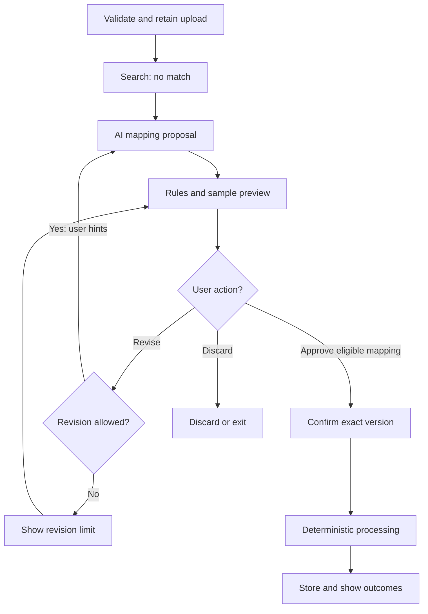
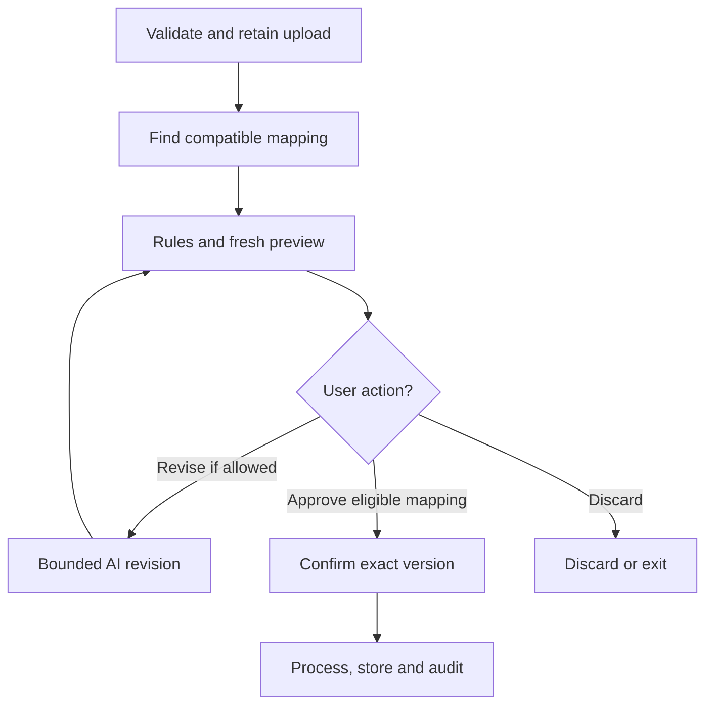
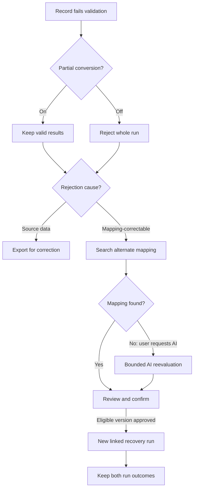

# Architecture workflows

Status: Step 4 discussion summary; required behavior and conceptual state, not an implemented workflow or selected architecture.
Date: 2026-10-26

## Purpose

Trace three representative paths before identifying logical responsibilities or selecting AWS services. This document summarizes the authoritative requirements; it does not replace them, prescribe an internal database schema, or add a UI requirement.

Diagram labels are shortened for readability; the surrounding walkthroughs retain the full checks, approval conditions, partial-conversion rules and retention boundaries.

All paths use the [Support Case contract](support-case-contract-v1.md). One input CSV record represents one source ticket. Canonical results remain inside the demo; no live CRM delivery, joins, or synchronization is required.

## Shared entry conditions and controls

- Human verification precedes interactive-session creation/cost-generating use; create the temporary identity and isolated workspace. Public explanation remains accessible when verification fails (FR-047).
- Explain CSV/record limits and obtain the synthetic-data-only acknowledgment before upload (FR-044). A downloadable sample uses the ordinary upload path (FR-042).
- Enforce workflow, workspace and owner-level usage/cost controls as applicable. Human verification does not replace them; financial shutdown needs manual operator intervention (NFR-8.3–8.5).
- Keep required audit/provenance metadata as material actions occur, not just at the final screen; never put business-record values into permanent audit or operational logs (NFR-3.8, NFR-6.1–6.6).
- Use bounded AI context. Do not retain assembled AI prompts/context after the interaction; the independently justified original upload follows NFR-7.2 (NFR-3.2–3.5).

## 1. New upload with no compatible approved mapping

### Flow overview

Shared access, usage, sensitive-data and timeout controls still apply. The numbered walkthrough below owns the detailed behavior; the chart focuses on the human-review loop. AI proposals may remain incomplete: confirmation is allowed only for eligible versions.

[Open full-size diagram](../assets/diagrams/workflow-new-mapping.svg) for zooming on smaller screens.

1. **Validate intake.** Reject unsupported/malformed, empty/header-only or unreadable content and uploads above the configured record limit (initially 50 data records, header excluded). Count parsed CSV records, not physical lines: comments can contain newlines. Reject an oversized file in full before search/inference; do not truncate (FR-003–005). These are intake checks, not a promise that every record will pass target validation.
2. **Capture the accepted original and check data exposure.** Preserve the unchanged received bytes under NFR-7.2 before mapping or transformation; intake checks/restricted staging may occur first. Apply the best-effort suspected-sensitive-data safeguard before further AI exposure. If flagged, pause and require an explicit false-positive assertion that no prohibited data is present, or stop/discard. A warning alone is insufficient; an assertion does not authorize actual prohibited data (FR-044A). The precise scan/staging order remains design work.
3. **Search approved mappings.** Search current-session approvals newest-to-oldest, then service-owned shared mappings newest-to-oldest; select the first compatible candidate bound to the current canonical version. In this scenario none is found (FR-006–010, FR-024–025).
4. **Request a bounded AI proposal.** Supply the canonical contract, mapping instructions, source schema and bounded sample values as needed. AI proposes reusable deterministic mapping/formatting rules or explains why a complete, unambiguous mapping cannot be established; do not fabricate missing source values (FR-011–012, FR-048).
5. **Pause for human review.** Show mapping rules, mapping/canonical versions, bounded transformed-sample preview, unmapped source fields and findings. Preview does not create a processing run, store successful business results or make an unapproved mapping reusable. Permit confirmation only for a complete, unambiguous mapping; otherwise allow hints/revision while attempts remain, or discard (FR-016–018).
6. **Bound revisions and confirm the exact version.** Allow one initial AI attempt and up to two user-requested revisions, showing remaining attempts. Supply the relevant prior mapping/context explicitly for revisions. Each revised proposal returns to review. At exhaustion, a complete/unambiguous latest proposal may still be confirmed; an incomplete/ambiguous one remains blocked. Approval binds to the exact reviewed version, not an unspecified latest version (FR-013–015).
7. **Approve and execute.** Persist the approved mapping version, canonical-version binding and approval provenance; it becomes reusable without private source values or prompts. Before processing, let the visitor set `Allow partial conversion` (default On). Enforce duplicate-request protection, create a uniquely identified run and apply the confirmed mapping deterministically; no runtime AI severity classification or comment rewriting (FR-019–028, FR-048; NFR-4.1).
8. **Complete storage/audit and show results.** Apply record validation and the selected partial-conversion behavior. Record the immutable outcome and counts, preserving exact mapping/canonical references. Store successful results and retained rejection details as applicable before reporting delivery. Show file-level outcome and before/after record details/rejection reasons within the review window (FR-029–034). Running-conversion visualization is optional. Apply each data category's retention policy; storage is part of completing the run, not only a later UI step.

## 2. New upload with a compatible approved mapping

### Flow overview

Reuse skips initial AI proposal generation, not review or confirmation. A requested change enters the bounded AI revision path and returns to review. Shared intake, original retention, access and usage rules remain applicable.

[Open full-size diagram](../assets/diagrams/workflow-reuse.svg) for zooming on smaller screens.

1. Repeat the shared controls, intake validation, original-file capture and applicable sensitive-data checks.
2. Search in the defined precedence order and establish compatibility with the current canonical model.
3. **Skip the initial AI mapping-generation request.** Reuse is not proof that every new record is valid.
4. Show the reused rules, versions, transformed sample preview, unmapped fields and findings for this upload. **Pause for fresh human confirmation.** Approval for reuse does not authorize processing future uploads automatically.
5. If the visitor requests AI changes, follow the bounded proposal/revision path and review the result before execution. Reuse alone does not require creating a new mapping version; an approved changed definition does.
6. After confirmation, use the same partial-conversion selection, duplicate-request protection, deterministic processing, storage, audit, result display and retention behavior as workflow 1.

The goal of reuse during an AI outage depends on compatibility evaluation being usable without the unavailable AI capability. That dependency is unresolved in the application profile; skipping proposal generation alone does not prove an AI-independent path.

## 3. Record failure and user-initiated recovery

### Flow overview

The original run applies the chosen partial-conversion policy before recovery starts. Recovery depends on retained input and user action; no branch below authorizes automatic retry or revision beyond the usage allowance.

[Open full-size diagram](../assets/diagrams/workflow-recovery.svg) for zooming on smaller screens.

If recovery is declined, cannot establish an eligible mapping, or has exhausted its allowance, offer export while input is retained. Otherwise valid records withheld by all-or-nothing delivery are not inherently invalid; their presentation/export grouping remains open.

1. **Distinguish mapping validity from record validity.** A correct mapping can encounter a blank required reporter last name in a particular ticket. A genuinely missing source value cannot be repaired by inventing data.
2. **Apply the partial-conversion setting.** With On, store valid records and separate failures with reasons (Partial Success when at least one succeeds and one fails; Total Failure if none succeeds). With Off, any record failure means zero stored canonical results and Total Failure. Distinguish invalid records from otherwise valid records withheld under all-or-nothing delivery; exact export grouping/UI treatment remains open (FR-026–032).
3. **Classify the failure.** If genuinely missing/invalid source data is unrecoverable within mapping, bypass mapping search and AI and provide export in the original format for correction. If the information exists but the mapping missed or misinterpreted it, mapping-correctable recovery may be appropriate (FR-035–037, FR-041).
4. **For mapping-correctable recovery, search before AI.** Try another compatible approved mapping first. If none resolves the issue, the user may request bounded AI reevaluation. Return any alternate/revised mapping to review and confirmation; do not automatically retry (FR-038–040; NFR-4.2).
5. **Create a new linked run.** User-approved reprocessing has its own request identity, mapping/canonical versions, audit and outcome. The original run's status, counts and mapping reference remain unchanged. Do not automatically replay already successful records; make the reprocessing input explicit. Whole-file retry after all-or-nothing failure is distinct from retrying only rejected records after partial success.
6. **Resolve, export or expire.** Show the new outcome and link to the original. Retain rejected-record content until resolution or its review-window expiration, subject to permitted early eviction. Respect source expiration without renewal for access/retry; original-file replay requires the original still to exist. If required retained input is no longer available, explain that recovery cannot proceed from it. A corrected new upload has a new upload lifecycle; linkage UX for externally corrected uploads is not selected here.

## State needed across interactions

This is a responsibility/state checklist, not a physical data-store design. Persistent storage does not imply cross-visit session recovery.

| State or artifact | Why needed | Ownership/lifetime boundary |
| --- | --- | --- |
| Temporary identity, workspace and access context | Scope private data, current-session search precedence and usage | Session/workspace scoped; no promise of returning-visitor recovery |
| Accepted original, upload identity and acceptance/expiration time | Preserve received bytes for bounded review/troubleshooting/recovery | Private, unchanged; 24 hours from acceptance, subject to early eviction; no reset on access/retry (NFR-7.2) |
| Current proposal, findings and review-version association | Support review, revisions and exact-version confirmation | Private working state; bounded cleanup. Retaining a proposal is not permission to retain AI prompt/context or private content in shared definitions |
| Attempt/usage counters and partial-conversion choice | Enforce limits and the requested processing behavior | Enforce across related requests; quota/reset values beyond the agreed AI attempt bound remain open |
| Approved mapping/version and canonical binding | Reuse deterministic configuration and identify exact executed rules | Service-owned shared definition without private content; version-retention period remains open (FR-019–025; NFR-7.6) |
| Processing-request identity and run/parent-run references | Prevent accidental duplicate runs and link intentional recovery | Run identity/provenance; duplicate-request storage duration/implementation remains open |
| Successful, rejected and record-review values | Show before/after outcomes and support permitted recovery/export | Private temporary business data; category-specific retention/early eviction (NFR-7.2–7.8) |
| Audit/provenance events and immutable run outcome | Explain approvals, processing, failures and recovery relationships | Append-only metadata retained after business values expire; no source/result/prompt payload copies |
| Operational metrics and financial protection state | Diagnose failures and constrain cost-generating activity | No business-record values in logs; mechanisms and detailed thresholds remain open |

## Cross-cutting failure boundaries

- Show system failures and stop at the defined hard timeout without hidden continuing processing; no automatic processing retries. Normal response targets are separate from the hard timeout (NFR-4.2, NFR-9.2).
- Closing the page does not cancel submitted work, but departure never supplies pending human approval. Continue only already-authorized work to its bounded outcome; returning-session recovery is not guaranteed.
- When AI is unavailable and compatibility cannot be established, explain the limitation and stop that workflow rather than silently resume later.
- Expired/evicted business data is unavailable even while audit metadata remains; a historical record is not an indefinite full-data archive.

## Open design questions

Mapping compatibility/representation; bounded preview/sample selection; hard timeout and numeric upload/field limits; quota values; working-state cleanup; how to enforce all-or-nothing storage, exact-version approval and idempotency; storage layout and execution orchestration. These are later design tasks, not answers selected by this workflow exercise.

## Sources and decision provenance

- [Functional requirements](functional-requirements-v1.md): FR-001–048.
- [Nonfunctional requirements](nonfunctional-requirements-v1.md): approval, isolation, audit, recovery, retention and cost constraints.
- [Pre-build application profile](application-profile-pre-build.md): workload, visitor-departure and outage boundaries.
- [Support Case contract](support-case-contract-v1.md).
- [System context](system-context.md) and [design drivers](architecture-design-drivers.md).

Erick supplied the first-upload sequence and correctly identified the reuse shortcut, the partial-versus-all-or-nothing distinction, and a separate recovery outcome preserving original run history. Discussion clarified preview before approval, precise revision exhaustion, failure classification, unchanged source retention and metadata-versus-business-data lifetimes. This artifact records that reasoning at logical-workflow depth.
