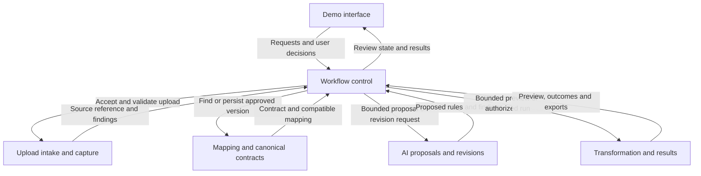
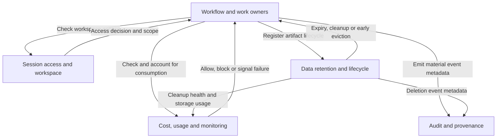

# Logical architecture

Status: Step 5 initial design baseline; logical responsibilities, not ten deployed services.
Date: 2026-10-26

## Purpose and scope

Group the work in the [architecture workflows](architecture-workflows.md) into clear owners before selecting AWS services. Related responsibilities may share one application, function or data store. This document selects logical boundaries only; physical storage, service mapping, protocols and concurrency mechanisms remain open.

The scenario remains support-ticket CSV onboarding into the versioned CRM-shaped Support Case contract, with human confirmation and deterministic execution. Existing requirements remain authoritative.

## Responsibility and ownership table

| Responsibility | Owns | Main state or artifacts |
| --- | --- | --- |
| Demo interface | Sample download, upload/review controls, preview/version/unmapped-field display, partial-conversion choice, progress/results/recovery/export views; submits user actions | Presentation state only; backend is authoritative for access, approval, quotas and outcomes |
| Session access and workspace management | Human-verification result validation; temporary identity/workspace creation and in-visit access checks; isolation context for all private operations | Session/workspace identity and access context; no enterprise login or promised cross-visit recovery |
| Upload intake and original-file capture | Intake validation, parsed-record counting, sensitive-data screening and pause/assertion handling, unchanged accepted-source capture | Original upload, upload identity, acceptance/expiration metadata and screening findings; private and short-lived under NFR-7.2 |
| Mapping and canonical contract management | Current canonical contract/version access; approved mapping definitions, versions and canonical bindings; precedence-ordered compatibility search and retrieval | Shared mapping definitions without private content; private associations supporting session search precedence; versioned canonical schema in GitHub |
| AI mapping proposals and revisions | Bounded inference request preparation, provider calls, proposed mapping rules and findings, explicit revision context and AI-context cleanup | Transient proposals/findings and provider-response metadata; no retained prompts/context after interaction and no authority to approve or execute |
| Workflow control and coordination | Current review version, confirmation eligibility/gates, approved-version authorization, allowed next actions, duplicate-request protection, run lifecycle, timeouts and user-initiated linked recovery | Review/confirmation association, run/request and parent-run identities, partial-conversion choice and authoritative operational run state |
| Deterministic transformation and results | Bounded preview evaluation; execute authorized mappings; target/record validation; partial versus all-or-nothing result delivery; rejection classification; result retrieval/export preparation | Temporary preview, successful results, rejected records and reasons, record-review views; exact mapping/canonical versions associated with output |
| Data retention and lifecycle management | Apply category-specific expiry, cleanup and storage-pressure eviction; preserve retained audit metadata; expose deletion failures and early-eviction notices | Retention/expiration and deletion bookkeeping; coordinates cleanup with each artifact owner rather than owning all business data |
| Audit and provenance | Append-only metadata across mapping, approval, overrides, runs, errors and recovery; preserve historical immutable run outcomes and references | Durable audit events, counts, classifications and mapping/canonical/parent-run references; never permanent source/result/comment/prompt payload copies |
| Cost and usage control and monitoring | Authoritative consumption counters/admission decisions, financial protection state, operational metrics and actionable alerts; quota reset and manual financial resume policy | AI/workspace/demo usage, quota/reset state, financial shutdown state and operational health metrics; exact quotas and mechanisms remain open |

Canonical version awareness is included (FR-024–025). The current contract/schema is maintained through GitHub/release processes; dynamic model administration, automated mapping migration/revalidation and a model-editing UI remain outside v1. Old-version mappings are ineligible for the changed current contract, not automatically deleted.

## Core logical relationships

Arrows identify responsibility interactions, not APIs, deployment boundaries or an exact chronological sequence. Intake includes accepted-source capture before mapping. The interface submits actions; workflow control enforces the resulting permissions.

A preview authorization is different from processing authorization: it permits bounded sample evaluation only. A run requires explicit confirmation of the eligible reviewed mapping version. The mapping owner provides the canonical contract and exact mapping rules to the AI/transformation paths; workflow coordinates their use without prescribing a data-copying implementation.

## Access, control and lifecycle relationships

The following complementary view accounts for the other four responsibilities. Enforcement is performed where work occurs; no browser-only check, singleton process, or particular orchestration service is implied.

Audit/monitoring receive events from all relevant work owners; the diagram does not require routing every event through one workflow process. Retention uses source, result, rejection and mapping policies independently; it does not purge retained audit history with business values.

## Main interaction and enforcement table

| Boundary | Information or action | Required guarantee |
| --- | --- | --- |
| Interface -> backend workflow | Confirmation/rejection, hints, partial-conversion setting, recovery request | Do not trust UI state as authority; validate workspace, current reviewed version, eligibility and permitted action |
| Workflow/work owner -> access and usage controls | Workspace/resource access and proposed cost-generating work | Enforce access and quotas before relevant work; monitoring alone does not prevent consumption |
| Intake -> mapping workflow | Validated source structure, private original reference and screening findings | Preserve accepted original before mapping; sensitive-data assertion gate before further AI exposure |
| Mapping management -> workflow | Compatible approved mapping/current canonical version, or no match | Current-session then shared precedence; semantic completeness and version compatibility, not file extension alone |
| AI proposals -> workflow/review | Candidate reusable rules and findings | AI returns a proposal, never approval or processing authority; incomplete/ambiguous candidates remain blocked |
| Workflow -> transformation | Bounded preview request or confirmed run with exact versions and partial-conversion choice | Keep preview separate from delivered results; prevent duplicate independent runs; no runtime LLM classification/rewriting |
| Workflow -> mapping management | Approval evidence plus eligible reviewed definition/version | Persist reusable rules and canonical binding without private source values, prompts, user identity or audit history in shared definitions |
| Transformation -> workflow/interface | Record outcomes, rejection classification, stored-result references and exports | Correct partial/all-or-nothing behavior; report successful delivery only after required storage/audit completion |
| Recovery workflow -> transformation | Explicit recovery input and a new request linked to the original run | Human review again where mapping changes; original outcome immutable; no automatic retries or silent replay of successful records |
| Artifact owners -> retention/audit/monitoring | Artifact identities/lifetimes and permitted event metadata | Delete business values by policy without restarting original-file expiry; preserve metadata-only history and surface failures |

## Boundary checks and open implementation questions

- AI attempt accounting is authoritative under cost/usage control; workflow enforces allowed transitions and the inference adapter must not bypass admission. A shared counter/reservation mechanism is not selected.
- Workflow owns operational run state; audit owns immutable historical evidence. Updating operational progress does not rewrite a completed run's audited outcome. Consistency/commit behavior across result storage, run outcome, approval persistence and audit is implementation design work.
- Mapping management owns approved definitions; workflow owns pending-review/confirmation state. Transformation evaluates mappings/records against the supplied canonical contract and reports validity findings used by the approval gate.
- Sensitive-data detection/false-positive assertion does not prove synthetic-data compliance. Access enforcement continues for previews, results, exports and recovery.
- Retention cannot erase pending work by accident or extend expired source content through copies/retries; timeout, retention-expiry and cleanup coordination must be designed.
- The owner-level financial shutdown/manual-resume policy and the provisional $20/month ceiling remain inputs; affordable service selection is unvalidated.
- The interface needs no separate admin portal, model editor or enterprise registration. Operator configuration and notification mechanisms remain open.
- Mapping compatibility during AI outages remains unresolved. No diagram claims that the reuse path is AI-independent before that decision is validated.

Next: map these responsibilities to candidate AWS capabilities, compare consequential alternatives, and produce the first cost estimate. Preserve separate approval/AI/runtime responsibilities even if several share an implementation component.

## Sources and decision provenance

- [Architecture workflows](architecture-workflows.md), [system context](system-context.md), and [design drivers](architecture-design-drivers.md).
- [Functional requirements](functional-requirements-v1.md), [NFRs](nonfunctional-requirements-v1.md), and [application profile](application-profile-pre-build.md).
- [Support Case contract](support-case-contract-v1.md).

Erick proposed seven responsibility groups, added workflow coordination and cost/usage monitoring after review, broadened mapping search into mapping/canonical contract management, and accepted the thin demo interface as the tenth responsibility. The tables clarify ownership and required interactions without selecting ten deployed services or an AWS architecture. Mermaid diagrams visualize the same agreed boundaries.
