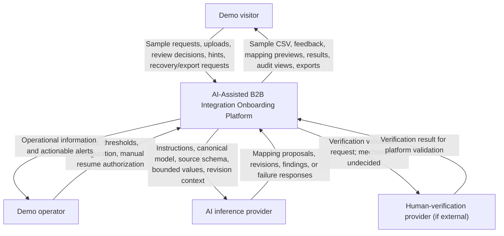

# System context

> Scope update (2026-10-25): v1 now uses flat support-ticket CSV uploads and a CRM-shaped canonical Support Case model. See [Support Case contract](support-case-contract-v1.md) for fields, validation and examples. This supersedes Company-centered wording; live CRM delivery, joins and ongoing synchronization remain outside v1.

Status: Step 2 discussion summary; logical context, not a deployment design.
Date: 2026-10-25

## Purpose and boundary

The AI-Assisted B2B Integration Onboarding Platform accepts manually uploaded support-ticket CSV files, finds reusable mappings or requests AI proposals, supports human review, and deterministically processes a confirmed mapping into its canonical Support Case model.

This view treats the platform as one system. Internal applications, storage, processing, and AWS service choices are intentionally omitted. A managed AWS service may implement part of the platform; being managed does not automatically make it an external system.

## Context diagram

Arrows describe logical exchanges, not selected protocols or exact network paths. The inference provider's hosting/access mechanism and the use of an external verification provider remain undecided. Visitor-to-verification-provider interactions, if required by the selected mechanism, are not yet specified.

## Interaction table

| External actor or dependency | Sends to platform | Receives from platform |
| --- | --- | --- |
| Demo visitor | Sample download request; synthetic CSV upload; mapping confirmation or rejection; revision hints; partial-conversion choice; recovery/export requests; required acknowledgments and verification evidence as applicable | Sample CSV; intake errors; mapping rules, version information, bounded transformed preview, unmapped fields and findings; processing status; successful/rejected-record details; workspace-scoped audit views; recovery outcomes and exports |
| Demo operator | Budget/cost thresholds, usage limits, retention configuration within the agreed policy; manual authorization to resume after a financial shutdown | Cost/usage information; actionable cost, system-failure and security warnings; cleanup status and failures. Mechanisms remain open; this does not require an admin UI. |
| AI inference provider | Suggested or revised mapping and explanatory findings, including unresolved fields; service/failure response when a request cannot be fulfilled | Mapping instructions and canonical target model; source schema plus a bounded sample of values where needed; the mapping being revised, relevant prior context and user correction hints |
| Human-verification provider, if external | A verification result indicating the visitor appears human, which the platform must validate | Verification validation request and only the evidence required by the eventual mechanism; exact payload and any direct visitor interaction remain open |

The platform sends requests to providers and receives their responses; the table columns use the platform's perspective.

## Platform-owned responsibilities

- Intake validation, unchanged accepted-source capture under NFR-7.2, and approved-mapping discovery before new AI inference.
- Validation of mapping eligibility, review/preview presentation and human confirmation.
- Approval tied to the exact reviewed mapping version; deterministic execution of the confirmed mapping.
- Partial-conversion behavior, duplicate-request protection, run outcomes and bounded recovery/export.
- Canonical-result storage, mapping version management and provenance.
- Temporary session/workspace access and private-data isolation.
- Retention, cleanup, append-only audit metadata, operational visibility and cost/usage enforcement.
- Validation of human-verification results before granting interactive access.

AI returns a proposal, not authority to execute. A model's claim that a mapping is complete does not prove correctness. Provider responses must be treated as inputs requiring platform checks.

## Data and trust boundaries

- AI receives source schema plus a bounded sample of values where needed, not the entire dataset by default. The sample bound and exact context needed for each task remain for design and testing.
- Revision calls include the relevant mapping and context explicitly; provider memory is not assumed.
- Minimize information exposed to inference. Application AI-context retention remains governed by the existing NFRs; provider retention behavior must be checked during selection.
- Reusable mapping definitions exclude source records, sample values, user prompts, user identity and private audit history.
- Workspace source files, results, rejected records and run details remain private to that workspace. The accepted original is retained unchanged only for the bounded source-file purposes and lifetime in NFR-7.2; later audit metadata does not substitute for deleted source bytes.
- Before confirmation, bounded preview is allowed; an actual processing run, successful-result storage and reuse of an unapproved mapping are not.
- Human verification is evidence that a visitor appears human, not a guarantee. Failed or unvalidated verification must not grant interactive access. Public project explanation and architecture information remain accessible; usage/cost controls continue after verification.

## Operator information versus alerts

The operator proposed cost, system-error, security, cleanup and demo-use notifications. Carry the following reviewer recommendations into detailed design:

- Alert on actionable failures and financial exposure; retain routine diagnostics as operational information.
- Record successful routine cleanup; prioritize notification of failed cleanup or retention-limit violations.
- A demo-use notification is an optional operator preference, not a prerequisite for the core demonstration. If implemented, exclude uploaded business content.
- After financial shutdown, require manual operator intervention to resume interactive processing. Exact mechanism remains open.

Notification channels, event thresholds and interfaces have not been selected.

## Explicit scope exclusions

- No separate downstream business application in v1: the demo's internal canonical data store represents successful delivery during the retention window.
- No direct integrations with source business systems: visitors upload files manually.
- No enterprise account registration, identity lifecycle administration, or approval hierarchy.
- No selected AWS services, inference model/vendor, verification provider, or notification channel in this view.

## Open design questions

- Concrete provider request/response contracts, bounded AI context and sample limits.
- Human-verification mechanism, validation details, failure handling and any direct browser/provider exchange.
- Operator configuration, actionable alert conditions and manual resume mechanism.
- AI-independent mapping compatibility and behavior during inference outages.
- Implementation of the [Support Case contract](support-case-contract-v1.md), including explicit bounds for comment formatting and input sizes.

## Sources and decision provenance

- [Problem definition](problem-definition.md)
- [Functional requirements](functional-requirements-v1.md)
- [Nonfunctional requirements](nonfunctional-requirements-v1.md)
- [Pre-build application profile](application-profile-pre-build.md)
- [Architecture design drivers](architecture-design-drivers.md)

Erick identified visitor, operator and inference exchanges, accepted the bounded source-schema/sample description, and described verification as evidence that a visitor appears human. Discussion clarified directions, approval responsibility and provider boundaries. Unselected mechanisms and optional reviewer recommendations remain labeled above.
